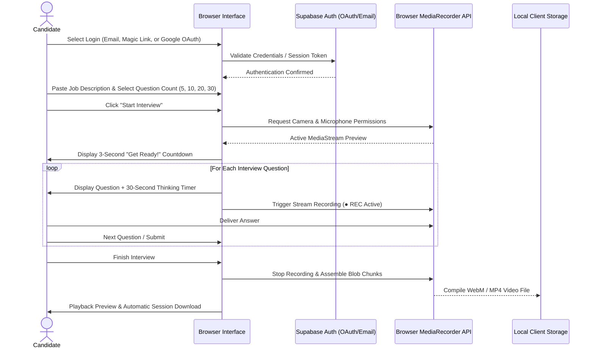

# Interviewpractice

[](https://raoabullah.github.io/Interviewpractice/)
[](https://developer.mozilla.org/)
[](https://supabase.com/)
[](https://webrtc.org/)
[](LICENSE)

> Developed during an **AI SaaS Product Internship at Technologia Solutions LLC**.

**Interviewpractice** is a full-featured, client-side interview simulation web application built to help candidates practice real-time technical and behavioral interviews. The application pairs custom job descriptions with targeted question sets, enforces authentic 30-second preparation timers, captures in-browser audio and video streams via the HTML5 `MediaRecorder` API, and provides instant session downloads—all designed around strict client-side privacy with zero server-side video storage.

---

## 📌 Project Overview

Traditional mock interview tools either rely on invasive video storage or lack authentic time-pressured environments. **Interviewpractice** solves this by providing:
1. **Dynamic Role Tailoring:** Users can paste any target job description to generate relevant, role-specific questions.
2. **Realistic Time Constraints:** A 3-second preparation countdown followed by a strict 30-second thinking timer per question.
3. **Local Media Recording:** Real-time synchronized audio and video capture directly in the browser.
4. **Privacy-Preserving Architecture:** Audio and video streams are processed exclusively in browser memory (Blob buffers) and downloaded locally by the user.

---

## 🏗️ System Architecture & Workflow



---

## 🌟 Key Features

* **Multi-Method Authentication:**
  * Email & Password authentication with input validation.
  * Passwordless **Magic Link** authentication.
  * One-click **Google OAuth** integration via Supabase.
* **Customizable Practice Sessions:**
  * **Role Tailoring:** Analyzes input job descriptions to serve contextual interview questions.
  * **Session Lengths:** Choose between 5 (Quick Practice), 10 (Standard), 20 (Comprehensive), or 30 Questions (Full Session).
* **Live Hardware Integration:**
  * Utilizes `navigator.mediaDevices.getUserMedia` for high-definition webcam and microphone access.
  * Live camera preview window so candidates can monitor eye contact, framing, and posture.
* **Timed Execution Environment:**
  * Animated 3-second transition overlay ("Get Ready!").
  * 30-second countdown timer per question to simulate real interview pressure.
* **Progress Tracking:** Real-time progress bar with active question indicators (`Q 1/10`) and dynamic state styling.
* **Instant Session Download:** Converts recorded video streams into downloadable files with timestamps for offline review.
* **Zero Video Server Footprint:** No candidate video or audio data is ever transmitted to external servers.

---

## 🛠️ Tech Stack

* **Frontend:** HTML5, CSS3 (Modern Glassmorphism UI, Responsive Flexbox & Grid layouts)
* **Application Logic:** Vanilla JavaScript (ES6+ Modules, Async/Await, Blob stream management)
* **Authentication & Backend:** Supabase Auth (`@supabase/supabase-js`)
* **Streaming & Media:** Native WebRTC `MediaStream`, HTML5 `MediaRecorder` API
* **Deployment:** GitHub Pages

---

## 📂 Repository File Structure

```text
Interviewpractice/
├── index.html        # Complete application UI (Auth views, setup forms, interview stage)
├── app.js            # Authentication logic, hardware stream capture, timers, recording logic
├── style.css         # Modern glassmorphism styling, animations, and responsive breakpoints
└── README.md         # Comprehensive project documentation
```

---

## 🚀 Getting Started

### Prerequisites
* Any modern web browser with camera and microphone support (Google Chrome, Microsoft Edge, Mozilla Firefox, Brave, Safari).

### Run Locally
1. Clone the repository:
   ```bash
   git clone https://github.com/RaoAbullah/Interviewpractice.git
   cd Interviewpractice
   ```
2. Open `index.html` directly in your browser, or serve via a local HTTP server:
   ```bash
   # Python 3
   python -m http.server 3000

   # Node.js (npx)
   npx serve .
   ```
3. Navigate to `http://localhost:3000` in your browser.

---

## 👤 Author
* **Rao Abdullah Nasir** — [GitHub](https://github.com/RaoAbullah) · [LinkedIn](https://www.linkedin.com/in/rao-abdullah-rajput) · [Email](mailto:abdullahnasirrao7@gmail.com)
