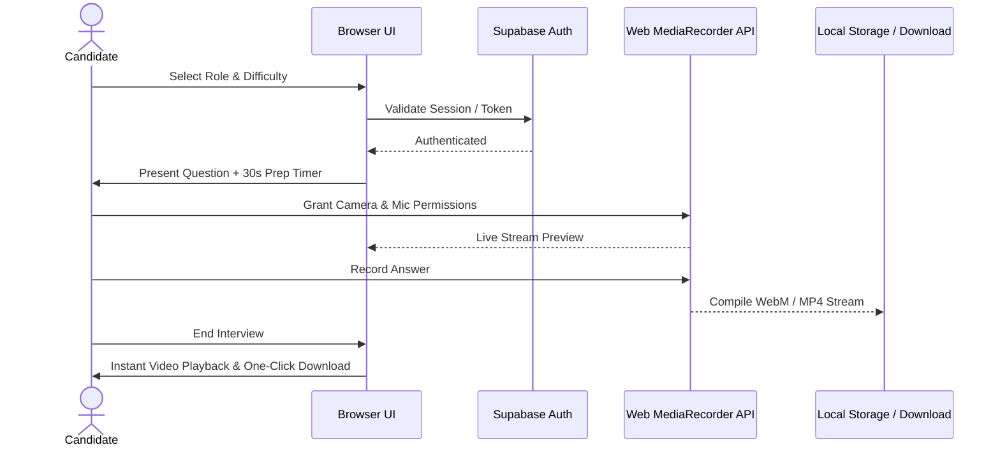

# 🎙️ PrepMaster: Role-Based Mock Interview Platform

[](https://raoabullah.github.io/Interviewpractice/)
[](https://developer.mozilla.org/)
[](https://supabase.com/)
[](https://webrtc.org/)
[](LICENSE)

> Built during an **AI SaaS Product Internship at Technologia Solutions LLC**.

PrepMaster is a client-side interview simulation web application that replicates high-pressure technical and behavioral interviews. It delivers role-specific question sets, enforces realistic prep timers, records synchronized audio/video responses locally, and enables instant session exports—with complete privacy and zero video server storage.

---

## 🏗️ System Workflow



---

## 🌟 Key Features

* **Targeted Domain Question Bank:** Curated question pools across multiple tech domains:
  * Software Engineering (Frontend, Backend, Full-Stack)
  * Data Science & Machine Learning
  * DevOps & Cloud Engineering
  * Product Management & UI/UX Design
* **Real-World Interview Constraints:** Enforces a configurable 30-second thinking countdown before auto-triggering response recording.
* **In-Browser Hardware Streaming:** Integrates native HTML5 `navigator.mediaDevices.getUserMedia` and `MediaRecorder` API for zero-latency audio/video capture.
* **Privacy-First Architecture:** Video recordings remain strictly in local memory/blob buffers; no video or audio data is ever transmitted to external servers.
* **Cloud Authentication:** Integrated with **Supabase Auth** for persistent user sessions, email sign-in/registration, and profile tracking.
* **Session Export:** Download full interview sessions with formatted timestamps for self-review or coaching feedback.

---

## 🛠️ Tech Stack

* **Frontend:** Modern Semantic HTML5, CSS3 Glassmorphism UI, Responsive Flexbox/Grid
* **Core Logic:** Vanilla JavaScript (ES6+ Modules, Async/Await, Blob streams)
* **Authentication:** Supabase Client SDK (`@supabase/supabase-js`)
* **Media Handling:** WebRTC `MediaStream`, `MediaRecorder` API
* **Deployment:** GitHub Pages

---

## 🚀 Getting Started

### Prerequisites
* Any modern web browser with camera and microphone access (Chrome, Edge, Firefox, Brave, Safari).

### Run Locally
1. Clone the repository:
   ```bash
   git clone https://github.com/RaoAbullah/Interviewpractice.git
   cd Interviewpractice
   ```
2. Open `index.html` directly in your browser or run via local server:
   ```bash
   # Using Python
   python -m http.server 3000

   # Or using VS Code Live Server
   ```
3. Navigate to `http://localhost:3000` in your browser.

---

## 👤 Author
* **Rao Abdullah Nasir** — [GitHub](https://github.com/RaoAbullah) · [LinkedIn](https://www.linkedin.com/in/rao-abdullah-rajput) · [Email](mailto:abdullahnasirrao7@gmail.com)
